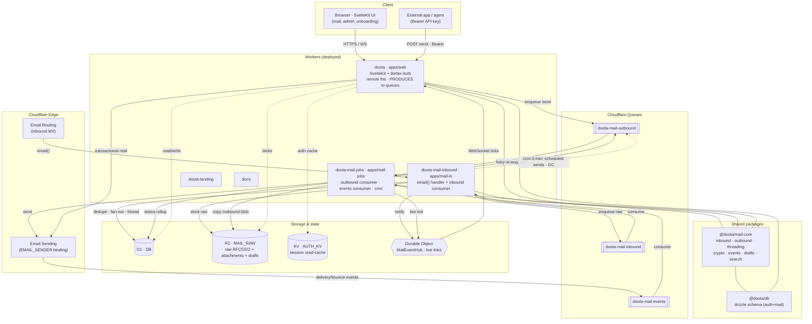
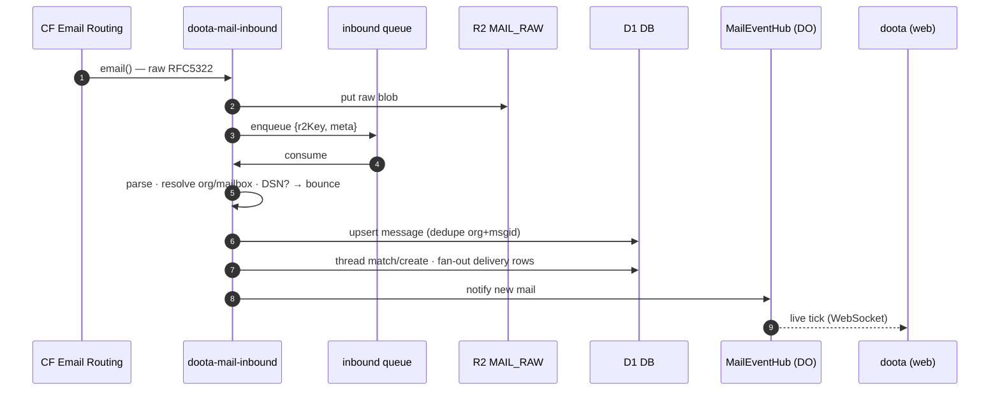
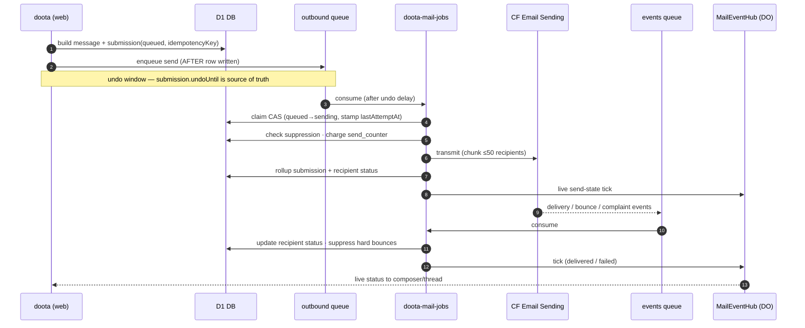

# PgMailCryP

Messagerie en développement à partir de [Doota](https://github.com/ethercorps),
avec une clé privée OpenPGP conservée sur l’appareil de l’utilisateur.

**État : pilote développeur de réception, pas encore une messagerie complète
zero-access ni une version de production.** Le domaine retenu pour le projet est
`anonyme.here`. Aucun DNS ou service pour ce domaine n’est configuré par le code.

## Ce qui fonctionne

- Génération/import de clé dans le navigateur, protection par phrase de passe,
  sauvegarde locale chiffrée, export et verrouillage.
- Publication de la clé publique pour une boîte personnelle autorisée ; aucune
  clé privée n’est envoyée par l’interface.
- Réception des nouveaux messages d’une boîte activée : MIME et pièces jointes
  chiffrés ensemble avec la clé publique avant stockage R2, index minimal dans D1.
- Lecture dans `/pgmailcryp`, déchiffrement et parsing MIME sur l’appareil,
  téléchargement des pièces jointes et export `.eml`.
- Endpoint authentifié `/ingress/stalwart` et chemin Cloudflare Email Routing.
  Le pont entre un véritable Stalwart et cet endpoint reste à implémenter.

Les fils, envois, brouillons, messages antérieurs et boîtes non activées gardent
le fonctionnement Doota avec `MAIL_DEK`, une clé connue des Workers. Les nouveaux
messages du pilote ne sont pas matérialisés dans les fils Doota ni dans son index
FTS. Les boîtes partagées, la rotation/récupération des clés, la pagination et la
lecture PGP/MIME imbriquée ne sont pas encore prises en charge par ce pilote.

Voir [le contrat technique, les données visibles et les tests](docs/pgmailcryp.md).

## Quand peut-on installer une version de test ?

**Dès maintenant pour les tests développeur automatisés depuis les sources.**
Il n’y a pas encore de paquet installable ni de release précompilée. Une version
avec de vrais courriels demandera un environnement isolé et une recette complète
SMTP → stockage → navigateur, avec vérification des pannes et des tentatives.
Aucune date de disponibilité en production n’est annoncée.

### Tests sans service mail externe

Prérequis : Node.js 22.18+ et pnpm à la version indiquée dans `packageManager`.
Les commandes suivantes n’effectuent aucun déploiement :

```sh
git clone --branch codex/pgmailcryp-receive-pilot https://github.com/williamcadev/PgMailCryP.git
cd PgMailCryP
pnpm install --frozen-lockfile
pnpm --filter doota gen
pnpm --filter doota exec vitest run src/test/pgp-ingress.test.ts
pnpm test
```

Les tests utilisent SQLite en mémoire, le vrai OpenPGP.js, des doublures R2/file,
et un jeu de messages synthétiques. Ils ne prouvent pas une livraison SMTP réelle.

### Application et courriels réels : préparation du pilote

1. Prévoir un compte et des ressources Cloudflare **réservés au test**. Les
   fichiers Wrangler contiennent encore les noms, identifiants et domaines Doota
   hérités : les remplacer par les valeurs du test avant tout démarrage connecté.
   `apps/web/wrangler.jsonc` contient des bindings R2 et Email Sender avec
   `remote: true` : le mode développement actuel n’est pas entièrement hors ligne.
2. Copier les trois `.dev.vars.example` vers `.dev.vars` dans `apps/web`,
   `apps/mail-in` et `apps/mail-jobs`, puis renseigner les secrets localement.
   Les véritables valeurs ne doivent jamais être commitées.
3. Appliquer les migrations locales avec `pnpm db:migrate:local`, puis lancer
   `pnpm dev`. Prévoir un compte membre disposant d’une boîte personnelle active ;
   créer un administrateur ne crée pas à lui seul la boîte de test nécessaire.
4. Ouvrir `/pgmailcryp`, générer/importer la clé, exporter une sauvegarde de la
   clé privée chiffrée et activer explicitement la boîte choisie.
5. Pour recevoir du vrai SMTP : raccorder ultérieurement Email Routing ou un pont
   Stalwart à une instance de test. Valider les livraisons, pièces jointes,
   refus d’accès, coupures R2/D1 et nouvelles tentatives avant d’utiliser une
   adresse importante. Le raccordement et le déploiement restent à réaliser.

### Machine de test prévue : Lenovo

Le serveur accessible via `ssh lenovo` est la cible prévue pour les essais.
Les sources et les tests pourront y tourner dans un environnement Node.js 22.18+
isolé (par exemple un conteneur Node.js 24), sans remplacer le Node système ni
modifier les services déjà présents. Stalwart et son pont pourront également y
être hébergés une fois leur intégration préparée.

L’application actuelle utilise les bindings Workers/D1/R2/KV/Queues : installer
les sources sur Lenovo ne remplace pas ces services. Pour le pilote connecté,
prévoir une instance Cloudflare de test ; une exécution entièrement locale
nécessite encore une configuration de bindings locaux dédiée. L’interface sera
ouverte dans le navigateur de l’utilisateur, où restera la clé privée.
Aucune installation Lenovo ni ouverture de port n’est réalisée par ce dépôt.

### Informations Cloudflare nécessaires

| Information | Usage |
| --- | --- |
| Identifiant du compte Cloudflare | Choisir le compte qui héberge les Workers et les ressources |
| Domaine, identifiant de zone et gestionnaire DNS de `anonyme.here` | Préparer ensuite le routage et le DNS ; ne pas supposer que Cloudflare héberge déjà la zone |
| URL de test de l’application | Définir `ORIGINS` ; `https://mail.anonyme.here` est une possibilité, pas une adresse déjà en service |
| Identifiants D1 et KV, nom du bucket R2, noms des files et Workers | Remplacer les bindings hérités ; les trois Workers partagent les ressources concernées |
| Transport entrant choisi | Email Routing avec catch-all vers `mail-in`, ou Stalwart avec son pont HTTP |
| Moyen d’envoi et adresses autorisées | L’envoi existant utilise le binding Cloudflare ; un relais SMTP externe demanderait encore un adaptateur |
| Authentification Cloudflare locale ou token API limité | Fournir l’accès via les outils/secrets locaux, jamais dans une issue, le README ou le chat |

Secrets applicatifs : `BETTER_AUTH_SECRET`, `SETUP_TOKEN` si le parcours `/setup`
est utilisé, `MAIL_DEK` et `MAIL_SEARCH_KEY` pour les chemins Doota encore actifs.
Les deux derniers doivent rester identiques entre les trois Workers. Selon les
fonctions utilisées : `APP_CLOUDFLARE_ACCOUNT_ID`, `APP_CLOUDFLARE_API_TOKEN`,
`MAIL_IN_WORKER_NAME`, `CRON_SECRET` et les clés VAPID. Les fichiers `.dev.vars.example`
donnent les emplacements. La clé privée OpenPGP et sa phrase de passe ne sont
jamais une configuration de serveur.

### Informations Stalwart nécessaires

- Version exacte et mode d’installation (Docker, binaire, autre), nom d’hôte,
  domaine(s) et boîtes/alias que le serveur reçoit déjà.
- État des MX et de la réception SMTP, du certificat TLS, et contraintes réseau
  entre le serveur/pont et l’endpoint HTTPS du Worker.
- Mécanisme d’intégration disponible dans cette version : il faut construire un
  pont de livraison durable ; un simple webhook d’observation ne garantit pas la
  conservation et la nouvelle tentative du courriel.
- URL du Worker suivie de `/ingress/stalwart`, secret partagé
  `STALWART_INGRESS_TOKEN`, plafond de taille et politique de retry/DSN.
- Pour un futur relais sortant : hôte, port, mode TLS, identité d’authentification,
  adresses autorisées et contraintes SPF/DKIM/DMARC. Le mot de passe ou token
  restera dans les secrets ; l’adaptateur d’envoi n’est pas implémenté ici.

Le pont transmet un destinataire SMTP par requête avec le MIME original en
base64. Il ne considère le message livré qu’après succès ; il conserve son spool
sur panne réseau ou 5xx. Le [contrat exact](docs/pgmailcryp.md#contrat-du-pont-stalwart)
distingue les erreurs permanentes des erreurs réessayables. Il ne faut pas
inventer une configuration Stalwart avant de connaître sa version et les
possibilités effectives de livraison de cette installation.

## Le serveur pourra-t-il ne plus voir le contenu SMTP ?

**Oui pour le contenu si l’expéditeur le chiffre avant de l’envoyer.** Avec un
client OpenPGP compatible et la clé publique du destinataire, le corps et les
pièces jointes peuvent parvenir au serveur déjà chiffrés. Le serveur reçoit
encore le SMTP et les métadonnées nécessaires : enveloppe d’expédition et de
destination, heures, tailles, et en-têtes externes non protégés. Ne pas supposer
que l’objet du message est masqué par tous les clients.

Pour un courriel ordinaire envoyé en clair par son auteur, **le premier serveur
SMTP qui le reçoit voit ce contenu**. Le pilote chiffre après réception : cela
protège le stockage, sans supprimer cet accès pendant l’ingress. Déplacer le
chiffrement vers Stalwart pourrait cacher le clair aux Workers, mais Stalwart le
verrait encore. Le chiffrement au repos de Stalwart avec une clé publique relève
également de ce deuxième cas. TLS protège la liaison ; il ne cache pas le message
au serveur qui termine cette liaison.

Le lecteur actuel déchiffre notre enveloppe de stockage puis parse le MIME.
Un courriel déjà chiffré en PGP/MIME peut donc rester chiffré à l’intérieur :
**le second déchiffrement PGP/MIME et l’envoi OpenPGP doivent encore être ajoutés**
pour offrir un vrai parcours de bout en bout. Les brouillons, copies envoyées,
caches et sauvegardes devront aussi être couverts avant une garantie globale.

Références : [OpenPGP/MIME, RFC 3156](https://www.rfc-editor.org/rfc/rfc3156.html),
[chiffrement Stalwart](https://www.stalw.art/docs/encryption/) et
[chiffrement au repos Stalwart](https://www.stalw.art/docs/encryption/at-rest/).

## GitHub et déploiements automatiques

Le workflow hérité `.github/workflows/deploy.yml` déploie sur Cloudflare après un
push sur **`main`**, ainsi que sur déclenchement manuel `workflow_dispatch`. Une
fusion dans `main` peut donc déclencher un déploiement. Le push de la branche
`codex/pgmailcryp-receive-pilot` ne correspond pas à ce déclencheur GitHub Actions.
Un éventuel projet Cloudflare Workers Builds connecté au dépôt possède ses
propres déclencheurs, à vérifier séparément dans le compte Cloudflare.

Les noms de domaines et commandes de déploiement dans la documentation Doota
ci-dessous décrivent le projet d’origine. Ils ne doivent pas être utilisés tels
quels pour `anonyme.here`. La publication du code sur une branche ne constitue
pas une installation ni une mise en production du pilote.

---

## Documentation Doota héritée

Les fonctions et garanties ci-dessous décrivent le fonctionnement Doota ; les
écarts et limites propres à PgMailCryP sont précisés plus haut.

## What is Doota?

Doota (say _DOO-tah_ — it means **messenger**) is a self-hosted email app that
runs entirely on your own [Cloudflare](https://cloudflare.com) account. No mail
server to babysit, no company sitting in the middle of your inbox. Mail arrives
through Cloudflare Email Routing, gets threaded into a WhatsApp-style
conversation, and is stored **encrypted at rest** — the raw message,
attachments, sent mail, and the derived render cache are all encrypted, with the
raw message kept whole as the source of truth.

**Two deliberate exceptions**, both worth knowing before you trust the claim:

**1 — a readable search index.** To provide fast full-text search, Doota keeps
the subjects and body text of your mail in a readable index. A database dump
could therefore recover the words in your mail this way (not formatting, not
attachments). This is the Fastmail posture — a reasonable trade for a
self-hosted tool where the operator already has legitimate access to their own
box. Set a mailbox to non-indexed to exclude it from search and the index
entirely.

**2 — attachments on an open draft.** A file you attach while composing is
stored unencrypted until that draft is sent or discarded. It is transient: it is
encrypted the moment the message goes to the outbound queue, and deleted when
the draft is closed. Everything already sent or received is encrypted.

It still speaks plain email underneath, so you can write to anyone on Gmail or
Outlook, and they can write back.

## Preview

<div align="center">

<picture>
  <source media="(prefers-color-scheme: dark)" srcset="apps/docs/public/media/thread-dark.png">
  
</picture>

<p><em>Every conversation as one chat-style timeline. Light or dark, following your system.</em></p>

<table>
  <tr>
    <td width="50%" valign="top">
      <picture><source media="(prefers-color-scheme: dark)" srcset="apps/docs/public/media/composer-dark.png"></picture>
      <br><strong>Composer</strong> — rich text, scheduled send, undo.
    </td>
    <td width="50%" valign="top">
      <picture><source media="(prefers-color-scheme: dark)" srcset="apps/docs/public/media/thread-mobile-dark.png"></picture>
      <br><strong>On a phone</strong> — the same app, re-shaped.
    </td>
  </tr>
</table>

<p><a href="docs/screenshots.md"><strong>More screenshots →</strong></a><br>
<sub>Phone, tablet, 13&#8221; laptop and desktop, light and dark.</sub></p>

</div>

## Features

- **Threads, not folders** — every conversation is one simple timeline of
  messages, interoperable with any mail client.
- **Runs on your own account** — Cloudflare Workers, D1, R2, KV, and Queues do
  the work. One deployment, one operator.
- **Private by default** — subjects, bodies, attachments, sent mail, and the
  derived render cache are all encrypted at rest; only routing metadata stays
  cleartext so threading works without decryption. Two documented exceptions:
  the readable search index, and attachments on a draft you haven't sent yet.
- **Undo & scheduled send** — a first-class submission object tracks every
  message (queued → sent → delivered → bounced), with delivery ticks and
  send-later.
- **Hide-my-email aliases** — generate throwaway addresses on your domain, map
  them to a mailbox, disable them anytime.
- **Passwords or passkeys** — WebAuthn sign-in out of the box.
- **Open source, end to end** — read it, run it, change it. No subscriptions,
  no per-seat pricing, no lock-in.

## Tech stack

| Layer    | Choice                                                                    |
| -------- | ------------------------------------------------------------------------- |
| Frontend | [SvelteKit](https://svelte.dev) + [Tailwind CSS](https://tailwindcss.com) |
| Runtime  | Cloudflare Workers (`@sveltejs/adapter-cloudflare`)                        |
| Storage  | D1 (SQLite) · R2 (raw messages) · KV (cache) · Queues (mail-out)           |
| Mail     | Cloudflare Email Routing (inbound) + provider seam (outbound)             |
| Auth     | [better-auth](https://better-auth.com) with passkeys                      |
| Data     | [Drizzle ORM](https://orm.drizzle.team) + drizzle-kit migrations          |

## Architecture

Diagrams below are generated from the code — the D1 schemas in
`packages/db/src/*.schema.ts` and each worker's `wrangler.jsonc`. The full set
(binding matrix + `@doota/mail-core` module map) lives in
[`docs/architecture-diagrams.md`](docs/architecture-diagrams.md).

### Component & deployment — services, bindings, pipeline

Five deployed Workers, two shared packages, one D1 / R2 / KV / Durable-Object
backbone. A queue binds to exactly **one** consumer Worker, so the app only
_produces_; the async handlers live in the two mail Workers.



| Worker | D1 `DB` | R2 `MAIL_RAW` | KV `AUTH_KV` | DO `MAIL_EVENTS` | `EMAIL_SENDER` | Queues |
| --- | :-: | :-: | :-: | :-: | :-: | --- |
| **doota** (web) | ✓ | ✓ | ✓ | ✓ | ✓ | produces `inbound`, `outbound` |
| **doota-mail-inbound** | ✓ | ✓ | — | ✓ | — | produces+consumes `inbound` |
| **doota-mail-jobs** | ✓ | ✓ | — | ✓ | ✓ | consumes `outbound`+`events`, produces `outbound`; cron |
| **doota-landing** | — | — | — | — | — | — |
| **docs** | — | — | — | — | — | — |

### ER diagram — data model (Cloudflare D1)

Two namespaces share one D1 database: **auth.\*** (Better Auth) and **mail.\***
(app owned). The load-bearing split — `message` is one immutable row per unique
email, `delivery` is the per-mailbox receipt, `thread_state` is per-mailbox
triage, `submission` is send state. Content columns (`*_enc`) are encrypted;
routing + threading metadata stays cleartext.

```mermaid
erDiagram
    user {
        text id PK
        text email UK
        text role "member|admin|superadmin"
        bool twoFactorEnabled
        int  onboardedAt
        text invitedByUserId FK "→ user"
    }
    session {
        text id PK
        text userId FK
        text activeOrganizationId
    }
    account {
        text id PK
        text userId FK
        text providerId
    }
    organization {
        text id PK
        text slug UK
        text domain UK
        text zoneId
        text status
    }
    member {
        text id PK
        text organizationId FK
        text userId FK
        text role
    }
    invitation {
        text id PK
        text organizationId FK
        text inviterId FK
        text email
    }
    twoFactor {
        text id PK
        text userId FK
    }
    passkey {
        text id PK
        text userId FK
    }

    orgMailSettings {
        text orgId PK
        bool subaddressingEnabled
        text returnPathDomain
    }
    mailbox {
        text id PK
        text orgId FK
        text address "org+address UK"
        bool isPersonal
        bool isService
    }
    mailboxAccess {
        text id PK
        text userId FK
        text mailboxId FK
        bool canSend
    }
    alias {
        text id PK
        text orgId FK
        text mailboxId FK
        text address
    }
    thread {
        text id PK
        text orgId FK
        int  lastMessageAt
    }
    message {
        text id PK
        text orgId FK
        text threadId FK
        text messageIdHeader "org+msgid UK"
        text fromAddr
        text r2RawKey
        text bodyFullEnc
        text bodyHtmlEnc
    }
    delivery {
        text id PK
        text orgId FK
        text messageId FK
        text mailboxId FK
        text viaAliasId FK
        text role "to|cc|bcc|from"
        bool isRead
    }
    threadState {
        text id PK
        text threadId FK
        text mailboxId FK
        text assigneeUserId FK
        text placement "inbox|archived|spam|trash|sent"
        bool isStarred
    }
    threadRead {
        text id PK
        text userId FK
        text threadId FK
        text mailboxId FK
    }
    label {
        text id PK
        text orgId FK
        text name
    }
    threadLabel {
        text id PK
        text threadId FK
        text mailboxId FK
        text labelId FK
    }
    attachment {
        text id PK
        text messageId FK
        text r2Key
    }
    internalNote {
        text id PK
        text threadId FK
        text mailboxId FK
        text authorUserId FK
    }
    systemEvent {
        text id PK
        text threadId FK
        text mailboxId FK
        text actorUserId FK
    }
    draft {
        text id PK
        text orgId FK
        text mailboxId FK
        text createdByUserId FK
        text threadId FK
        text fromAliasId FK
        text kind "new|reply|reply_all|forward"
        text status "editing|sending|sent"
        text submissionId
    }
    submission {
        text id PK
        text orgId FK
        text messageId FK
        text mailboxId FK
        text fromAliasId FK
        text createdByUserId FK
        text idempotencyKey UK
        text status "queued|sending|…|delivered|bounced"
        int  undoUntil
    }
    submissionRecipient {
        text id PK
        text submissionId FK
        text address
        text role
        text status
    }
    suppression {
        text id PK
        text orgId FK
        text address
        text reason
    }
    sendCounter {
        text id PK
        text scope
        text scopeKey
    }
    apiKey {
        text id PK
        text orgId FK
        text userId FK
        text mailboxId FK
        text keyHash UK
    }

    user ||--o{ session : has
    user ||--o{ account : has
    user ||--o{ member : "belongs via"
    user ||--o{ twoFactor : has
    user ||--o{ passkey : has
    user ||--o{ invitation : sends
    user |o--o{ user : invited
    organization ||--o{ member : has
    organization ||--o{ invitation : has

    organization ||--|| orgMailSettings : configures
    organization ||--o{ mailbox : owns
    organization ||--o{ alias : owns
    organization ||--o{ thread : owns
    organization ||--o{ message : owns
    organization ||--o{ label : owns
    organization ||--o{ suppression : owns
    organization ||--o{ apiKey : owns

    mailbox ||--o{ mailboxAccess : "granted to users"
    user    ||--o{ mailboxAccess : granted
    mailbox ||--o{ alias : "forwards from"
    mailbox ||--o{ delivery : receives
    mailbox ||--o{ threadState : triages
    mailbox ||--o{ draft : "composed in"
    mailbox ||--o{ submission : "sends from"
    mailbox ||--o{ apiKey : "sends as"

    thread  ||--o{ message : contains
    thread  ||--o{ threadState : "per mailbox"
    thread  ||--o{ threadRead : "read cursors"
    thread  ||--o{ threadLabel : tagged
    thread  ||--o{ internalNote : notes
    thread  ||--o{ systemEvent : events
    message ||--o{ delivery : "fans out to"
    message ||--o{ attachment : has
    alias   ||--o{ delivery : "received via"
    label   ||--o{ threadLabel : applied

    message ||--o{ submission : "sent as"
    submission ||--o{ submissionRecipient : "fans out to"
    user ||--o{ draft : owns
    user ||--o{ submission : sent
```



### Mail pipeline — sequence

Inbound (receive):



Outbound (send + undo + provider events):



## Getting started

Requires Node 22+, [pnpm](https://pnpm.io), and a Cloudflare account.

### 1. Create the Cloudflare resources

`wrangler deploy` reconciles *bindings*, but it never creates the things they
point at — and the `MAIL_RAW` bucket is bound with `"remote": true`, so **even
local dev talks to the real bucket**. Create these first or `pnpm dev` won't
boot:

```sh
wrangler d1 create doota                  # id → database_id in all three wrangler.jsonc
wrangler r2 bucket create doota-mail-raw
wrangler kv namespace create AUTH_KV      # id → web + mail-in
wrangler queues create doota-mail-inbound
wrangler queues create doota-mail-outbound
wrangler queues create doota-mail-events
```

### 2. Configure secrets

Local dev reads each Worker's `.dev.vars` — **not** `.env`, which only exists
for drizzle-kit. Copy the templates and fill them in:

```sh
pnpm install
cp apps/web/.dev.vars.example       apps/web/.dev.vars
cp apps/mail-in/.dev.vars.example   apps/mail-in/.dev.vars
cp apps/mail-jobs/.dev.vars.example apps/mail-jobs/.dev.vars

openssl rand -base64 32              # → MAIL_DEK        (back this up first — see below)
openssl rand -base64 32              # → MAIL_SEARCH_KEY
openssl rand -base64 32              # → BETTER_AUTH_SECRET
pnpm --filter doota exec node scripts/gen-vapid-keys.mjs  # → VAPID_PUBLIC_KEY + VAPID_PRIVATE_KEY
```

`MAIL_DEK` and `MAIL_SEARCH_KEY` must be **identical across all three Workers** —
they read and write the same encrypted rows. A mismatch isn't a startup error; it
shows up later as unreadable mail.

### 3. Run it

```sh
pnpm db:migrate:local     # apply D1 migrations to the local database
pnpm dev                  # http://localhost:5173
pnpm --filter doota reset-admin   # create the first admin (genesis) — email-free, enrolls TOTP
```

`ORIGINS` must include the port you actually serve on, or every `/api/auth/*`
route 404s.

Mail delivery needs more: an Email Routing catch-all pointing at your deployed
`mail-in` Worker, and DKIM on the sending domain. Neither is expressible in
`wrangler.jsonc` — see [`docs/pre-release.md`](docs/pre-release.md) §0.5 for the
full provisioning list.

### Environment

See `apps/web/.dev.vars.example` for the full list — that is the file local
dev reads. (`.env` is drizzle-kit only.) The essentials:

- `ORIGINS` — comma-separated allowed origins; the first is canonical. Must
  include the port you actually serve on, or auth routes 404.
- `BETTER_AUTH_SECRET` — 32+ chars, high entropy.
- `MAIL_DEK` — the 32-byte (base64) data-encryption key for all mail content.
  Set as a Worker **secret** on `web`, `mail-in`, and `mail-jobs` — the same
  value on all three. See the warning below.
- `MAIL_SEARCH_KEY` — HMAC key for blind **note** search tokens and signed
  image/resource tokens. (Message search is a plaintext FTS5 index and does not
  use this key.) Also a secret on all three Workers.

> [!CAUTION]
> **Back up `MAIL_DEK` before you store a single message — losing it is permanent
> and total data loss.**
>
> Every message, attachment, and sent copy is encrypted with `MAIL_DEK`. There is
> **no plaintext path** to your mail and **no recovery**: no support reset, no
> partial reconstruction, no backdoor. If the Worker secret is ever lost, rotated
> without the old value, or overwritten, **every message you have ever received
> becomes permanently unreadable.**
>
> Generate it once, store the base64 value in a password manager / secrets vault
> **outside Cloudflare**, then set it as a secret on all three Workers:
>
> ```sh
> # generate (32 random bytes, base64) — save the output somewhere safe FIRST
> openssl rand -base64 32
>
> wrangler secret put MAIL_DEK            # doota (web)
> wrangler secret put MAIL_DEK --config apps/mail-in/wrangler.jsonc
> wrangler secret put MAIL_DEK --config apps/mail-jobs/wrangler.jsonc
> ```
>
> The same rule applies to `MAIL_SEARCH_KEY` (lose it and search + inline images
> break, though mail stays readable). Treat both as unrecoverable-if-lost.
- `APP_CLOUDFLARE_ACCOUNT_ID` / `APP_CLOUDFLARE_API_TOKEN` — a **scoped** API
  token (not the Global API Key), stored as a Worker secret in production.
- `MAIL_IN_WORKER_NAME` — the deployed mail-in Worker the catch-all rule targets.
- `LOG_LEVEL` — optional mail-pipeline log level (`debug`/`info`/`warn`/`error`,
  default `info`); set per Worker (web, mail-in, mail-jobs) as a plain var.

### Deploy

```sh
pnpm db:migrate:remote    # migrate the production D1 database
pnpm deploy               # build + wrangler deploy
```

## Repository layout

- `apps/web/` — application SvelteKit et atelier PgMailCryP.
- `apps/mail-in/` — Worker de réception Cloudflare et endpoint Stalwart.
- `apps/mail-jobs/` — Worker des envois et tâches différées Doota.
- `packages/db/` et `packages/mail-core/` — schéma et pipeline mail partagés.
- `drizzle/` — migrations et snapshots.
- `apps/landing/` et `apps/docs/` — site et documentation Doota hérités.

## Useful scripts

| Script             | Does                                      |
| ------------------ | ----------------------------------------- |
| `pnpm check`       | auth-boundary check + `svelte-check`      |
| `pnpm test`        | run the Vitest suite                      |
| `pnpm db:studio`   | open Drizzle Studio                       |
| `pnpm --filter doota auth:schema` | regenerate the better-auth Drizzle schema |
| `pnpm --filter doota gen` | regenerate Cloudflare binding types       |

## Status

Doota is under development and moving fast. Star the repo to follow along until launch.

## License & credits

An independent open-source project by **[Ethercorps](https://github.com/ethercorps)**.

Not affiliated with, endorsed by, or sponsored by Cloudflare. Cloudflare,
Workers, R2, and D1 are trademarks of Cloudflare, Inc.

© 2026 Ethercorps
